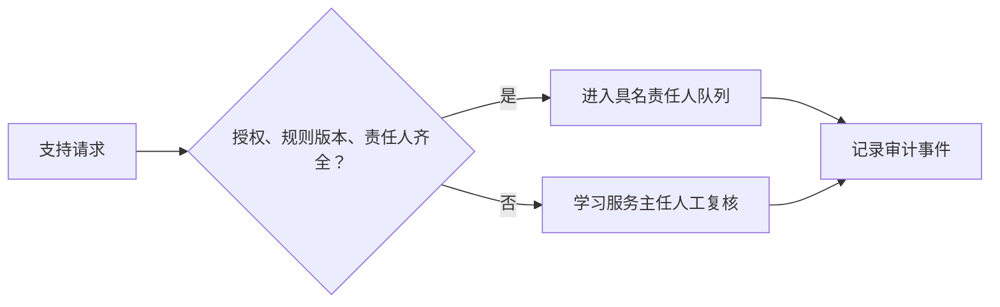

# 设计说明

## 问题与目标

本项目为“学习支持与辅导协作”FDE 训练场景实现一个最小闭环。目标不是以 AI 替代决策，而是把支持请求在进入处理队列前变成可核对的服务任务，减少因授权、规则版本和责任人缺失造成的返工。

## 最小闭环

`core.workflow.evaluate_request` 是唯一决策点：

- 授权未确认：不得自动继续；
- 规则版本不匹配：不得自动继续；
- 无具名责任人：不得自动继续；
- 通过三项控制后，才标记为 `ready_for_assignment`。

## 数据与权限边界

样例数据为匿名合成记录。生产落地前，数据专员需确认最小字段、留存期、可见范围和脱敏规则；平台工程师需实现身份认证、访问控制和不可篡改审计。原型不连接生产系统、不生成对学生的建议、不自动改写课程或成绩。

## 可验证性

单元测试覆盖正常分流与三项控制缺失的回退。命令行 `--demo` 输出每个决定、原因、下一责任人与审计事件，便于复核。
